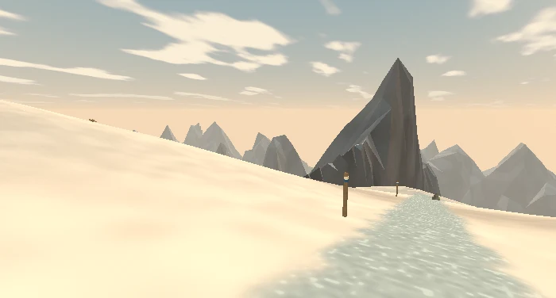

# Mountain

A quiet first-person hiking game with twelve destinations on Earth and beyond. Follow a marked trail to a snowy pass, listen for a note on a black-sand beach, or photograph Earth above a crater rim. Call a wood cabin into the landscape when you want to come inside.

[Play the browser build](https://stbange.github.io/mountain/) · [Download desktop builds from the latest successful playtest run](https://github.com/stbange/mountain/actions/workflows/playtest.yml)

## On the trail

Larkspur Ridge opens at a meadow trailhead. Follow the earth path and the timber posts with a cream and rust blaze. The first cairn marks **Lakeside View** and the second marks **Ridge Lookout**. From Ridge Lookout the marked trail continues indefinitely. Follow the blazes between cairns or leave the path to explore in any direction. **Trail map** shows the two opening stops near the trailhead. Farther out, it shows local contours, your position and heading, distance walked, and the next stretch of trail. The same seed reproduces the terrain and trail on your return. Enter a seed to revisit a mountain or choose **Generate a new mountain**.

Choose **Taggart Lake · Wyoming** in the map to walk beneath the Teton Range. The terrain comes from USGS 3DEP public-domain survey elevations. In this play-scale landscape each game metre represents five metres of terrain horizontally and vertically. The map and altimeter report geographic metres. Beyond the survey boundary, the measured landscape blends into imagined alpine backcountry. The game generates the route, plants and wildlife throughout. [USGS source and attribution](assets/CREDITS.txt)

## The high route

At **Ridge Lookout**, follow the blue and white blazes on the summit branch to climb switchbacks into permanent snow. The High Pass dips between two horns. The narrower upper ridge leads to the summit and a view back down the route. The climb gains roughly 450–550 game metres depending on the seed. Open **Trail map → Summit route** to see the whole ascent. The other trail at the fork crosses a succession of snowy high passes and lower valleys as you hike farther into the backcountry.

Watch the ground past the last cairn. Moving toward a steep drop brings up a footing warning. If you step over it, you fall briefly and return to the last safe section of trail. You keep your photographs, field notes and cabin.

## Destinations and discoveries

Open **Trail map → Choose a destination** on the web, or use **[** and **]** on desktop. The five new Earth hikes are procedural interpretations of their regions. The existing Taggart Lake hike uses survey elevations. Beyond Earth, Mare Imbrium is a procedural lunar landscape, and the other four settings are fictional.

| Destination | What to look for | Field skill |
| --- | --- | --- |
| Larkspur Ridge | A split cairn at the fork, then brass needles in the snow | Take a bearing |
| Taggart Lake, Wyoming | Amber flakes left on a glacial erratic | Read evening light |
| Sarakiniko, Milos, Greece | Peach shells on white tuff above the Aegean | Take a bearing |
| Erg Chebbi, Sahara, Morocco | Salt-marked reeds and a sundial between palm oases | Read evening light |
| Reynisfjara, Iceland | Hollow basalt columns on black sand | Sound three notes |
| Canyonlands, Utah | Turquoise seams in sandstone fins above the canyon | Take a bearing |
| Li River, Guilin, China | Cut bamboo pipes beneath limestone towers | Sound three notes |
| Mare Imbrium, the Moon | Silver survey reflectors on the ejecta | Take a bearing |
| Prism Choir | Singing facets growing from a violet ridge | Sound three notes |
| Lantern Mycelium | Spore cups and luminous gills beneath giant caps | Read evening light |
| The Hanging Sea | Coral vanes below floating reefs and a ringed planet | Take a bearing |
| Emberglass Caldera | Obsidian splinters above a glowing caldera | Sound three notes |

Read the first sign with **E**, the touch interaction prompt or **Select** in VR. Follow what it tells you. For a sighting, look along the pair of markers. For a sound puzzle, walk to each pipe and sound it from shortest to tallest. For an evening reading, wait for the light or choose **Golden hour**. The last clue points toward a treasure you can see, approach and photograph. The field guide keeps your clues and collection across visits and restarts on the same device. All discoveries are optional. **Generate a new trail here** opens a different seed in the same region.

## Life on the mountain

Open **Season & weather** or click the season beside your elevation. Pick spring, summer, autumn or winter and choose the sky or time of day. A manual selection holds that condition. **Cycle through seasons** and **Let the weather change** run independently. Changing trails retains your chosen conditions. Spring glacier lilies give way to summer paintbrush and lupines, then autumn seed heads. In suitable daylight, butterflies and bumblebees visit the flowers. Winter precipitation falls as snow.

Firs, spruce, larches and aspens grow from seeded voxel trunks and branches. Larch and aspen turn gold in autumn and lose their foliage in winter. Watch for mule deer at meadow edges, red foxes and snowshoe hares under cover, yellow-bellied marmots on rocky slopes, and golden eagles circling above. Hares turn white in winter and marmots hibernate. On the web, **Field guide** lists the species near your current position.

Ridges cast broad shadows and the gaps between fir branches let sunlight reach the trail. Clouds move across the sky and the ground together. At Erg Chebbi, sand lends shaded slopes an amber cast. On the Moon, crater rims cast sharply defined shadows.

The **Summon** button places the local shelter ahead of you. Its footings follow the slope. In an alpine grove, a mature tree can carry the cabin platform. Other destinations use stone footings, guy ropes, bamboo stilts or capsule landing legs. Open the front door to see the Hearth Room, then walk through. The rear and right-hand doors start closed. Opening one reveals a room you can look into before stepping through. The rear door of the Hearth Room leads to the spring baths, and its right door leads to the winter garden. Both have railed balconies. Other branches include bedrooms, reading rooms, a map gallery and a sunroom. The front door of each room retraces your route. Press **R** to return to the Hearth Room from any room, balcony or trail.

Beside a window, press **E** to swing its glass pane and **J** to raise or lower its blind. The house remembers its rooms, door positions, panes and blinds when you dismiss it, travel to another world or restart the game on this device. The exterior entrance closes when you summon the cabin again.

In **Trail conditions**, choose one of three local phenomena and switch either sighting on or off. These controls start off and remember your choices when you travel. They affect the view from the shelter and its balconies. The visitors never detect or pursue you. Each enabled sighting shows its compass bearing and approximate distance from your shelter. Summon near the shore to see marine events. Lightning can be heard when sound is enabled. Lunar impacts throw silent arcs of regolith against a black sky.

| Destination | Summoned shelter | Local phenomena | Optional sightings |
|---|---|---|---|
| Larkspur Ridge | Timber cabin | Thunderstorm, snowstorm, heavy fog | Wolf pack, ridge giant |
| Taggart Lake | Ranger cabin | Teton thunderstorm, pass whiteout, glacial lake fog | Grizzly bear, bull moose |
| Sarakiniko | Cycladic boathouse | Meltemi spray, breaking swells, sea fog | Barracuda shoal, waterspout |
| Erg Chebbi | Caravan tent | Sandstorm, dust devils, heat shimmer | Horned vipers, collapsing dune |
| Reynisfjara | Turf shelter | Atlantic gale, sneaker waves, sea fret | Orca pod, basalt rockfall |
| Canyonlands | Sandstone field hut | Dry lightning, dust storm, canyon haze | Cougar, tumbling boulder field |
| Li River | Bamboo stilt house | Monsoon rain, river surge, karst mist | Bamboo pit vipers, flood debris |
| Mare Imbrium | Lunar capsule | Micrometeor impacts, ejecta fans, lofted regolith | Runaway survey rover, crater-wall landslide |
| Prism Choir | Prism capsule | Prism lightning, crystal shardfall, violet veil | Glass mantises, facet walker |
| Lantern Mycelium | Sporefilter capsule | Spore squall, lantern bloom, bioluminescent mist | Spore stalkers, lantern grazer |
| The Hanging Sea | Flotation capsule | Gravity squall, sky tide, reef mist | Ribbon rays, sky leviathan |
| Emberglass Caldera | Thermal capsule | Emberfall, volcanic lightning, ash cloud | Cinder hounds, basalt colossus |

**Camera** opens the viewfinder. Take a photograph, then open **Photo journal** to view it or download its PNG. The browser keeps photographs in IndexedDB on that browser and device. Native photographs are lossless BMPs in the SDL user preference directory for Mountain. The window title and console show the saved path.

| Control | Desktop | Touch web |
| --- | --- | --- |
| Move | W A S D or up/down arrows | Thumb pad |
| Look | Drag the web view or use left/right arrows. On native, click to capture the mouse and Esc to release it. | Drag the landscape |
| Summon or dismiss the cabin outdoors | H | Cabin button |
| Open a door or cross the nearby threshold | E or walk through an open door | Door prompt or thumb pad |
| Close or reopen any door from either side | F beside the door | Close door or Open door |
| Open or close a glass pane / adjust its blind | E / J beside the window | Window / blind buttons |
| Local phenomenon / first sighting / second sighting | K / L / X | Trail conditions |
| Return to the Hearth Room | R | Hearth room button |
| Photograph | P. On web, C opens the viewfinder. | Camera, then Take photo |
| Sound | M | Speaker button |
| Guide | G on web, F1 on native | Field guide |
| Conditions | V opens the web panel. Y changes season, U changes weather and T advances the hour. Native I toggles seasonal cycling and O toggles changing weather. | Season & weather |
| Destination | Trail map on web. On native, B opens Taggart Lake and N generates a new mountain. | Trail map |

On an immersive-VR-capable browser, open **Field guide → Enter VR**. Head tracking supplies the views. Use the left stick to hike, the right stick to snap-turn, the trigger to read a sign or use a door, and squeeze to summon or dismiss outdoors. Indoors, the trigger opens a pane or uses a door, the left grip operates its blind or door latch, and the right grip returns to the Hearth Room. On controllers with X and Y face buttons, X changes season and Y changes weather. The right secondary face button advances the time of day for dusk clues. Indoors, X toggles the first local sighting, Y cycles the local phenomenon and the right secondary button toggles the second sighting. WebXR requires HTTPS or localhost.

## Build

Use CMake 3.24+, Python 3, a C11 compiler and a desktop OpenGL driver with framebuffer objects. CMake downloads hash-pinned SDL 3.2.24 and Lua 5.4.8. It links them into the application and stages editable content beside the binary. Linux needs the X11 or Wayland development headers, OpenGL/EGL development headers and an audio backend. The Linux CI job lists a working Ubuntu package set.

~~~sh
cmake -S . -B build -G Ninja -DCMAKE_BUILD_TYPE=Release
cmake --build build
~~~

Run **build/play/mountain** on Linux or **build/play/mountain.exe** on Windows. Use a Visual Studio developer shell for Ninja on Windows. Multi-configuration generators put the selected configuration under play/. Keep the adjacent assets directory with the executable.

For the web, activate Emscripten 4.0.20 and build the same sources.

~~~sh
emcmake cmake -S . -B build-web -G Ninja -DCMAKE_BUILD_TYPE=Release -DMOUNTAIN_TESTS=OFF
cmake --build build-web
python3 -m http.server 8000 --directory build-web/play
~~~

Open http://localhost:8000/. Serve the entire directory. The loader reads the manifest and fetches the individual assets relative to the game URL, including when deployed under /mountain/.

## Engine and content

| Location | Responsibility |
| --- | --- |
| src/world.c, src/backcountry.c, src/game.c and src/cabin.c | Seeded ridges, continuous trail sections, local coordinates, hiking and cabin state |
| src/route.c and src/survey.c | Grade-aware trail search, viewpoint selection, trail texture and survey interpolation |
| assets/terrain/taggart.mht | Resampled public-domain terrain and lake footprint |
| src/realms.c, src/expedition.c and src/landmarks.c | Regional landforms, graded summit route, footing, field clues and scenery placement |
| src/forest.c and src/fauna.c | Voxel tree growth, seasonal crowns, wildlife habitats and movement |
| src/mesh.c, src/scene.c and src/render.c | Terrain meshes, meadow sprites, reflective water, window views and OpenGL passes |
| src/script.c | Loads Lua content and exposes room and animal geometry builders |
| src/app.c and web/ | SDL input, sound and photos, browser controls, journal and WebXR |
| assets/scripts/world.lua | Starting trail, relief, water, pace, clock, names, tree branching shapes and seasonal palettes |
| assets/scripts/wildlife.lua | Animal anatomy, coats, gait, posture and wing animation |
| assets/scripts/destinations.lua and assets/scripts/landmarks.lua | Atlas entries, discovery text, profile palettes, lighting settings and landmark shape builders |
| assets/scripts/cabin.lua | Floor plans, window openings, furniture, fixtures, materials and room titles |
| assets/art, assets/shaders and assets/sound | Original bitmap art, GLSL and loopable PCM ambience |

To reproduce the Taggart Lake terrain asset, run `python tools/prepare_taggart.py USGS_1_n44w111.tif assets/terrain/taggart.mht` with Pillow installed. The input tile used for this release has SHA-256 `ec3e6b490cdd5035af94952a0d6b4415c42b15da6a85ebeae75edaeb51c9afe5`. The preparation tool records the trailhead coordinates and samples a 40-metre grid.

The loose catalogue in `assets/scripts/shelters.lua` pairs a shelter with its three phenomena and two sightings. A destination uses its terrain profile as the catalogue key by default or can set `shelter` in its destination table. Each sighting names a Lua model, habitat, group size and scale. The model receives a gait phase and a drawing callback.

Edit the staged Lua or art files and reopen the game to see changes without recompiling. To add a room design, extend build_room in cabin.lua. The builder takes centred boxes in metres, colour, material, yaw, optional roof tilt and an optional light radius in metres. Material 7 marks a glowing fixture. The renderer takes up to four local lights, starting with the active room. Room zero is the main cabin. The engine stores compact records for discovered rooms and builds geometry for the active room and its open doorways. Append room types to cabin_layouts in cabin.lua to preserve the identity of saved layouts. Destination slots in destinations.lua identify saved journal entries. Append slots to extend a content pack. A destination selects a C terrain profile and a field skill. Its lighting table sets sky and ground-bounce RGB intensities, cloud influence from 0 to 1, and shadow softness from 0 (sharp) to 2. Its Lua artwork uses tapered strokes to construct scenery and relics, and the atlas photography lives in web/ui/atlas/.

## Specifications and tests

OpenSpec records the accepted behaviour in openspec/specs/. The test suite checks deterministic terrain, climate, cabin collisions, door apertures, reproducible rooms, graphics, input and audio. Coverage uses native GCC/gcov for the project's C sources and Lua debug line hooks for gameplay scripts. Third-party sources are outside both totals. The browser suite drives actual input and framebuffer draws, including an emulated tracked headset.

~~~sh
npx --yes @fission-ai/openspec@2.1.0 validate --all --strict
cmake -S . -B build-test -G Ninja -DCMAKE_BUILD_TYPE=Debug -DMOUNTAIN_COVERAGE=ON
cmake --build build-test
ctest --test-dir build-test -R '^unit$' --output-on-failure
python3 tools/coverage.py build-test
ctest --test-dir build-test -R '^(lua-content|game)$' -V
python3 -m pip install -r tests/requirements.txt
python3 -m playwright install chromium
python3 tests/browser.py build-web/play
~~~

Use a fresh coverage build to measure the unit run independently. For headless Linux set SDL_VIDEO_DRIVER=offscreen, EGL_PLATFORM=surfaceless, SDL_AUDIO_DRIVER=dummy and LIBGL_ALWAYS_SOFTWARE=1. An existing Chromium executable can be selected with CHROMIUM. The live playtest walks more than five game kilometres on each of two seeds, returns to the same lookout, visits a remote cabin and writes a photograph. Unit tests also query trail sections millions of intervals apart, regenerate trees and habitat cells, compare level-of-detail meshes, and check seasonal wildlife. Browser tests open the map beyond the old boundary, download a photo, reload the journal and exercise phone controls.

## Branches and licensing

Development takes place on **main**. **gh-page** contains the staged browser distribution. The playtest workflow builds Linux, Windows and Web, runs their checks and advances gh-page after they pass. GitHub Pages serves the root of that branch at the play link above.

Code and shaders are licensed under [MIT](LICENSE). Original sprite art, models, palette work, interface artwork and ambience are licensed under [CC BY 4.0](assets/LICENSE-ART.txt). [Art attribution](assets/CREDITS.txt) and [third-party notices](THIRD-PARTY.txt) accompany the distributions.
