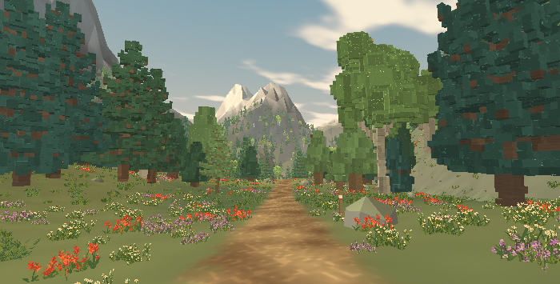
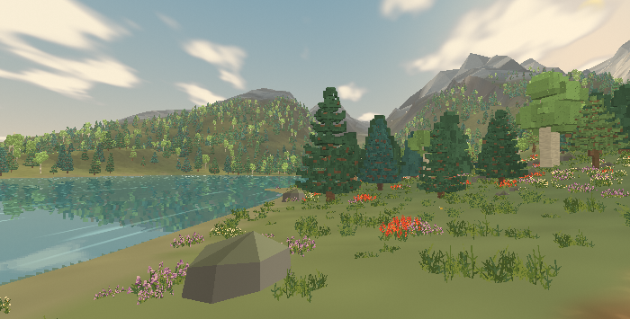

# Mountain

A quiet first-person hiking game set on Earth. Follow the trail from Larkspur Ridge to the lake, then keep walking into new mountain ranges. Wait for the light to reach a summit or a deer to lift its head, and take a photograph. Call a wood cabin onto the trail when you want to come inside.

[Play the browser build](https://stbange.github.io/mountain/) · [Download desktop builds from the latest successful playtest run](https://github.com/stbange/mountain/actions/workflows/playtest.yml)

## On the trail

Larkspur Ridge opens at a meadow trailhead. Follow the earth path and the timber posts with a cream and rust blaze. The first cairn marks **Lakeside View** and the second marks **Ridge Lookout**. From Ridge Lookout the marked trail continues indefinitely. Follow the blazes between cairns or leave the path to explore in any direction. **Trail map** shows the two opening stops near the trailhead. Farther out, it shows local contours, your position and heading, distance walked, and the next stretch of trail. The same seed reproduces the terrain and trail on your return. Enter a seed to revisit a mountain or choose **Generate a new mountain**.

Choose **Taggart Lake · Wyoming** in the map to walk beneath the Teton Range. The terrain comes from USGS 3DEP public-domain survey elevations. In this play-scale landscape each game metre represents five metres of terrain horizontally and vertically. The map and altimeter report geographic metres. Beyond the survey boundary, the measured landscape blends into imagined alpine backcountry. The game generates the route, plants and wildlife throughout. [USGS source and attribution](assets/CREDITS.txt)

Open **Season & weather** or click the season beside your elevation. Pick spring, summer, autumn or winter and choose the sky or time of day. A manual selection holds that condition. **Cycle through seasons** and **Let the weather change** run independently. Changing trails retains your chosen conditions. Spring glacier lilies give way to summer paintbrush and lupines, then autumn seed heads. In suitable daylight, butterflies and bumblebees visit the flowers. Winter precipitation falls as snow.

Firs, spruce, larches and aspens grow from seeded voxel trunks and branches. Larch and aspen turn gold in autumn and lose their foliage in winter. Watch for mule deer at meadow edges, red foxes and snowshoe hares under cover, yellow-bellied marmots on rocky slopes, and golden eagles circling above. Hares turn white in winter and marmots hibernate. On the web, **Field guide** lists the species near your current position.

**Summon cabin** places a furnished lodge ahead. Its footings follow the slope. In a grove, a mature tree at the edge of the floor can carry the platform. Open the front door to see the Hearth Room, then walk through. The door at the far end leads to another room. Rooms are regenerated from their index as you move. Their windows look back onto the current mountain. Walk back the way you came, or use **R** to return to the entrance. Step outside to dismiss the house.

**Camera** opens the viewfinder. Take a photograph, then open **Photo journal** to view it or download its PNG. The browser keeps photographs in IndexedDB on that browser and device. Native photographs are lossless BMPs in the SDL user preference directory for Mountain. The window title and console show the saved path.

| Control | Desktop | Touch web |
| --- | --- | --- |
| Move | W A S D or up/down arrows | Thumb pad |
| Look | Drag the web view or use left/right arrows. On native, click to capture the mouse and Esc to release it. | Drag the landscape |
| Summon or dismiss the cabin outdoors | H | Cabin button |
| Open a door or cross the nearby threshold | E or walk through an open door | Door prompt or thumb pad |
| Return to the Hearth Room | R while indoors | Hearth room button |
| Photograph | P. On web, C opens the viewfinder. | Camera, then Take photo |
| Sound | M | Speaker button |
| Guide | G on web, F1 on native | Field guide |
| Conditions | V opens the web panel. Y changes season, U changes weather and T advances the hour. Native I toggles seasonal cycling and O toggles changing weather. | Season & weather |
| Destination | Trail map on web. On native, B opens Taggart Lake and N generates a new mountain. | Trail map |

On an immersive-VR-capable browser, open **Field guide → Enter VR**. Head tracking supplies the views. Use the left stick to hike, the right stick to snap-turn, the trigger to use a door, and squeeze to summon or dismiss outdoors. On controllers with X and Y face buttons, X changes season and Y changes weather. WebXR requires HTTPS or localhost.

## Build

Use CMake 3.24+, Python 3, a C11 compiler and a desktop OpenGL driver with framebuffer objects. CMake downloads hash-pinned SDL 3.2.24 and Lua 5.4.8. It links them into the application and stages editable content beside the binary. Linux needs the X11 or Wayland development headers, OpenGL/EGL development headers and an audio backend. The Linux CI job lists a working Ubuntu package set.

~~~sh
cmake -S . -B build -G Ninja -DCMAKE_BUILD_TYPE=Release
cmake --build build
~~~

Run **build/play/mountain** on Linux or **build/play/mountain.exe** on Windows. Use a Visual Studio developer shell for Ninja on Windows. Multi-configuration generators put the selected configuration under play/. Keep the adjacent assets directory with the executable.

For the web, activate Emscripten 4.0.20 and build the same sources.

~~~sh
emcmake cmake -S . -B build-web -G Ninja -DCMAKE_BUILD_TYPE=Release -DMOUNTAIN_TESTS=OFF
cmake --build build-web
python3 -m http.server 8000 --directory build-web/play
~~~

Open http://localhost:8000/. Serve the entire directory. The loader reads the manifest and fetches the individual assets relative to the game URL, including when deployed under /mountain/.

## Engine and content

| Location | Responsibility |
| --- | --- |
| src/world.c, src/backcountry.c and src/game.c | Seeded ridges, continuous trail sections, local coordinates, hiking and cabin state |
| src/route.c and src/survey.c | Grade-aware trail search, viewpoint selection, trail texture and survey interpolation |
| assets/terrain/taggart.mht | Resampled public-domain terrain and lake footprint |
| src/forest.c and src/fauna.c | Voxel tree growth, seasonal crowns, wildlife habitats and movement |
| src/mesh.c, src/scene.c and src/render.c | Terrain meshes, meadow sprites, reflective water, window views and OpenGL passes |
| src/script.c | Loads Lua content and exposes room and animal geometry builders |
| src/app.c and web/ | SDL input, sound and photos, browser controls, journal and WebXR |
| assets/scripts/world.lua | Starting trail, relief, water, pace, clock, names, tree branching shapes and seasonal palettes |
| assets/scripts/wildlife.lua | Animal anatomy, coats, gait, posture and wing animation |
| assets/scripts/cabin.lua | Floor plans, window openings, furniture, fixtures, materials and room titles |
| assets/art, assets/shaders and assets/sound | Original bitmap art, GLSL and loopable PCM ambience |

To reproduce the Taggart Lake terrain asset, run `python tools/prepare_taggart.py USGS_1_n44w111.tif assets/terrain/taggart.mht` with Pillow installed. The input tile used for this release has SHA-256 `ec3e6b490cdd5035af94952a0d6b4415c42b15da6a85ebeae75edaeb51c9afe5`. The preparation tool records the trailhead coordinates and samples a 40-metre grid.

Edit the staged Lua or art files and reopen the game to see changes without recompiling. To add a room design, extend build_room in cabin.lua. The builder takes centred boxes in metres, colour, material, yaw and optional roof tilt. Room zero is the main cabin. The renderer holds the active room and its immediate neighbours, so memory usage stays bounded as the hiker explores. Additional terrain types or planetary sky models can extend the C generator and the Lua world definition.

## Specifications and tests

OpenSpec records the accepted behaviour in openspec/specs/. The test suite checks deterministic terrain, climate, cabin collisions, door apertures, reproducible rooms, graphics, input and audio. Coverage uses native GCC/gcov for the project's C sources and Lua debug line hooks for gameplay scripts. Third-party sources are outside both totals. The browser suite drives actual input and framebuffer draws, including an emulated tracked headset.

~~~sh
npx --yes @fission-ai/openspec@2.1.0 validate --all --strict
cmake -S . -B build-test -G Ninja -DCMAKE_BUILD_TYPE=Debug -DMOUNTAIN_COVERAGE=ON
cmake --build build-test
ctest --test-dir build-test -R '^unit$' --output-on-failure
python3 tools/coverage.py build-test
ctest --test-dir build-test -R '^(lua-content|game)$' -V
python3 -m pip install -r tests/requirements.txt
python3 -m playwright install chromium
python3 tests/browser.py build-web/play
~~~

Use a fresh coverage build to measure the unit run independently. For headless Linux set SDL_VIDEO_DRIVER=offscreen, EGL_PLATFORM=surfaceless, SDL_AUDIO_DRIVER=dummy and LIBGL_ALWAYS_SOFTWARE=1. An existing Chromium executable can be selected with CHROMIUM. The live playtest walks more than five game kilometres on each of two seeds, returns to the same lookout, visits a remote cabin and writes a photograph. Unit tests also query trail sections millions of intervals apart, regenerate trees and habitat cells, compare level-of-detail meshes, and check seasonal wildlife. Browser tests open the map beyond the old boundary, download a photo, reload the journal and exercise phone controls.

## Branches and licensing

Development takes place on **main**. **gh-page** contains the staged browser distribution. The playtest workflow builds Linux, Windows and Web, runs their checks and advances gh-page after they pass. GitHub Pages serves the root of that branch at the play link above.

Code and shaders are licensed under [MIT](LICENSE). Original sprite art, models, palette work, interface artwork and ambience are licensed under [CC BY 4.0](assets/LICENSE-ART.txt). [Art attribution](assets/CREDITS.txt) and [third-party notices](THIRD-PARTY.txt) accompany the distributions.
